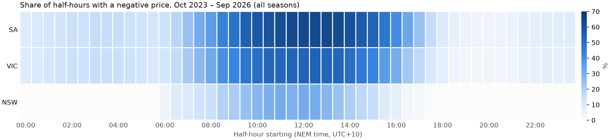
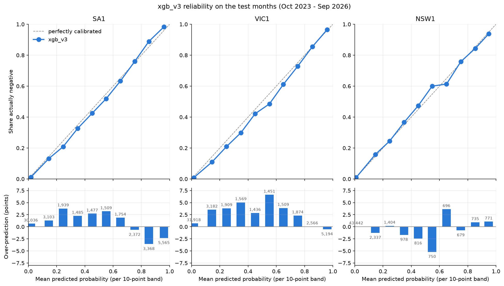

# NEM Negative Price Forecasting

## Summary

This project forecasts, at 13:00 NEM time on the previous day, which half-hours of the next day will have a negative electricity price in South Australia (SA), Victoria (VIC) and New South Wales (NSW). It uses public data from the National Electricity Market (published by AEMO, the Australian Energy Market Operator) and SILO weather data. An XGBoost classifier with 26 features per region (including AEMO's pre-dispatch price and demand forecasts, AEMO's rooftop solar forecast and recent price history) was backtested over 36 months (Oct 2023 – Sep 2026), using only information available at the time each forecast would have been issued. Its Brier score was lower than that of AEMO's own price forecast converted into a calibrated probability: 12.3% lower in NSW (95% CI 8.5–15.7%), 9.3% in SA (6.2–12.3%) and 15.4% in VIC (11.7–19.2%).

In a simulated 2-hour battery cycling once a day, a charging rule driven by these forecasts earned more than an optimiser driven by AEMO's forecast prices alone. The difference was A$10,321/MW/year in SA (95% CI 6,091–14,456; +7.7%) and A$1,136/MW/year in NSW (245–2,521; +0.8%). In VIC the difference (A$646/MW/year, CI −324 to 1,603) is not distinguishable from zero.

How the model and the battery rule were chosen, including the versions tried, is described under [Limitations](#limitations).




## Results

All numbers: 36 test months (Oct 2023 – Sep 2026), 52,608 scored half-hours per region, identical rows for every model. Intervals are 95% monthly-block bootstrap intervals.

### Forecast skill

Brier skill score vs AEMO recalibrated (positive = lower Brier score than the reference):

| Model | NSW | SA | VIC |
|---|---|---|---|
| **XGBoost** | **+12.3%** [+8.5, +15.7] | **+9.3%** [+6.2, +12.3] | **+15.4%** [+11.7, +19.2] |
| Chronos-2 with covariates | +5.9% [+1.3, +10.5] | −14.3% [−19.9, −8.7] | +3.6% [−1.4, +8.8] |
| Chronos-2 price only | −20.4% [−26.8, −14.6] | −94.1% [−105.3, −83.9] | −77.4% [−86.7, −67.8] |
| Seasonal-naive baseline | −51.6% [−63.2, −40.8] | −116.1% [−130.1, −102.6] | −98.9% [−111.0, −87.0] |
| AEMO raw (forecast price < $0, no interval computed) | −85.6% | −27.9% | −32.2% |

XGBoost in detail:

| | NSW | SA | VIC |
|---|---|---|---|
| Share of half-hours negative | 8.7% | 27.4% | 23.4% |
| Mean forecast probability | 8.6% | 27.8% | 24.7% |
| Brier score: AEMO recalibrated → XGBoost | 0.0432 → 0.0379 | 0.0697 → 0.0632 | 0.0711 → 0.0601 |
| AUC: AEMO recalibrated → XGBoost | 0.954 → 0.966 | 0.957 → 0.967 | 0.953 → 0.967 |
| Recall / precision (XGBoost) | 78% / 62% | 88% / 80% | 85% / 79% |



### Battery value

Simulated 1 MW / 2 MWh battery, A$/MW/year (share of the perfect-foresight ceiling in brackets):

| Strategy | NSW | SA | VIC |
|---|---|---|---|
| Perfect foresight (ceiling) | 216,113 | 230,842 | 137,725 |
| **Rule driven by XGBoost** | **145,151** (67.2%) | **143,807** (62.3%) | **92,938** (67.5%) |
| Same rule driven by AEMO recalibrated | 143,668 (66.5%) | 141,052 (61.1%) | 90,553 (65.7%) |
| Optimiser on AEMO forecast price only | 144,015 (66.6%) | 133,486 (57.8%) | 92,292 (67.0%) |

Differences (XGBoost rule minus reference), A$/MW/year:

| Reference | NSW | SA | VIC |
|---|---|---|---|
| AEMO forecast price only | +1,136 [+245, +2,521]; +0.8%; 25/36 months | +10,321 [+6,091, +14,456]; +7.7%; 31/36 | +646 [−324, +1,603]; +0.7%; 22/36 |
| AEMO recalibrated (same rule) | +1,483 [+600, +2,881]; +1.0%; 27/36 | +2,755 [+1,144, +4,483]; +2.0%; 26/36 | +2,385 [+1,275, +3,620]; +2.6%; 31/36 |

The interactive dashboard (where negative prices occur by region and hour, forecast vs actual, scorecard) is in `reports/dashboard/negprice_dashboard.pbix`, with a PDF export alongside.

## Method

**Question.** At 13:00 NEM time on day D−1, what is the probability that each of the 48 half-hours of day D has a negative price, in SA, VIC and NSW?

**Target.** A half-hour is negative when its mean price (average of the six 5-minute dispatch prices) is below $0. One label per region per half-hour.

**Issue time and leakage rule.** Forecasts are issued at 13:00 on D−1. That is when AEMO publishes its first pre-dispatch run covering all of day D, right after the 12:30 deadline on D−1 for bids for day D. Every feature has a "known at" timestamp, and only data known by 13:00 on D−1 is allowed. Tests enforce this rule (`tests/test_features.py`). All times are NEM time (UTC+10, no daylight saving).

**Features** (one model per region; full list in `references/data_dictionary.md`):
- Calendar: half-hour, local hour, day of week, weekend, public holiday, month
- AEMO's 13:00 pre-dispatch run for day D: price, demand, net interchange, available generation, semi-scheduled solar and wind; forecast prices of the neighbouring regions (including QLD and TAS)
- AEMO rooftop PV forecast (latest version before 12:30 on D−1) and its age
- Recent history: share of negative half-hours at the same time of day over D−29 … D−2, negatives on the morning of D−1, price at the same half-hour on D−2
- SILO observed weather on D−2 (the latest complete day at issue time)

**Backtest.** Rolling origin with a sliding 24-month training window ending two days before the test month, and one-month test blocks stepping monthly. That gives 36 test months per region (Oct 2023 – Sep 2026), each scored once by a model that never saw it. Hyperparameters and the yes/no cutoff are chosen inside each fold on the last 3 months of the training window, then the model is refit on the full 24 months. No test month is used for any choice within a fold. Administered-pricing days (13–24 Jun 2022) are kept for training but never scored.

**Models** (all scored on identical rows):

| Model | Description |
|---|---|
| XGBoost | Gradient-boosted trees, per region; depth and number of trees chosen per fold on validation Brier |
| Chronos-2 with covariates | Zero-shot foundation model (no training on this data), with 6 weeks of price history plus AEMO forecasts, rooftop PV forecast, weather and holidays |
| Chronos-2 price only | Same, price history only |
| Seasonal-naive baseline | Share of negatives at the same half-hour on the same weekday over the previous 8 weeks |
| AEMO raw | 1 if AEMO's 13:00 forecast price is below $0, else 0 |
| AEMO recalibrated (reference) | Logistic regression of the actual outcome on AEMO's forecast price (clipped to ±$50), one curve per region and hour block, refit per fold |

AEMO recalibrated is the reference: it turns AEMO's own price forecast into a fair probability, so beating it means adding information beyond AEMO's forecast, not just correcting its $0 cutoff.

**Metrics.** Brier score (headline); Brier skill score vs AEMO recalibrated; recall and precision at the per-fold cutoff (max F1 on validation); AUC and F1. Uncertainty: monthly-block bootstrap (36 months resampled with replacement, 10,000 times, 95% percentile intervals).

**Battery value.** A simulated 1 MW / 2 MWh battery, one cycle a day, 85% round-trip efficiency, no degradation. The whole day D is planned at 13:00 on D−1 and settled at actual half-hour prices. The rule charges in the half-hours with the highest forecast probability of a negative price (above the fold's cutoff) before the evening block, falls back to AEMO's forecast prices when no half-hour reaches the cutoff, and sells in the highest-forecast-price half-hours after charging. Benchmarks: the same rule driven by AEMO recalibrated, and an optimiser on AEMO's forecast price alone. The ceiling is the optimal schedule with perfect foresight. Results are in A$/MW/year, with monthly-block bootstrap intervals.


## Limitations

### How the model and the battery rule were chosen

Every number in this README comes from the 36 test months, but some design choices were made after earlier results on those months had been seen. All versions are reported so the reader can judge the effect.

**Three XGBoost versions were scored on the test months.** The headline uses the third.

| Version | What changed | BSS vs AEMO recal: NSW / SA / VIC |
|---|---|---|
| v1 | One fixed setting (500 trees, depth 6) | 5.8% / 5.0% / 11.0% |
| v2 | Depth and number of trees tuned per fold on validation months | 12.0% / 8.8% / 15.1% |
| v3 (headline) | Adds QLD and TAS forecast prices as features | 12.3% / 9.3% / 15.4% |

v2 and v3 were developed after v1's test results had been seen. Within each version, every choice (settings, cutoff, whether to adopt v3) used validation months only, and v3's adoption rule was fixed before it was run. The QLD and TAS features lowered validation Brier by only 0.1–0.2%, with intervals including zero, so there is no evidence they help. Every backtest run is logged with its date and commit in `reports/backtest/runs.csv`.

**Three battery rules were tried.** The headline uses the third. Rule 2 was written after rule 1's test results; rule 3 fixes a partial-charging flaw noticed after rule 2's test results. The "AEMO forecast price only" benchmark was added after rule 1. All three rules are reported in `reports/battery/differences.csv`. Across rules and regions there are 15 comparisons, so about one result with p < 0.05 is expected by chance.

**Other choices informed by all years.** The ±$50 clip in AEMO recalibrated was read from an exploration table covering all years, test months included.

### Limitations of the results

- **One period.** Results cover Oct 2023 – Sep 2026. Batteries and rooftop solar keep changing the market, so performance may not carry forward. Bootstrap intervals reflect month-to-month variation within this period, and neighbouring months are correlated, so the intervals are somewhat too narrow.
- **Simplified battery.** The battery cycles once a day, has 85% round-trip efficiency and no degradation cost, plans the whole day at 13:00 on D−1 with no intraday re-optimisation, and is a price-taker (its trades don't move prices). The A$ figures are simulated arbitrage, not profit. The forecast-driven rule captures 62–68% of the perfect-foresight value.
- **Cutoff is not a business rule.** Recall and precision use the cutoff that maximises F1 on validation months. A battery operator would set it from costs, and the numbers would change.
- **Interconnectors.** QLD and TAS enter only through their forecast prices. Interconnector flows and limits are not modelled.
- **Weather.** No archived weather forecasts are used. Day-D weather enters only through AEMO's forecasts. SILO revises recent days as late station reports arrive, so values downloaded today can differ slightly from what was available at the time.
- **Calibration.** In VIC, XGBoost over-predicts in the 10–70% probability range by about 3–7 percentage points (reliability plot in `reports/figures/`). No recalibration step was added: its estimated gain was under 1 point of Brier skill score.
- **Comparing regions.** Brier score depends on how often prices go negative, so compare models within a region (skill score), not regions with each other.

## Reproduce

**Requirements:** Linux (tested on Ubuntu; should also work on macOS), Python 3.12, [uv](https://docs.astral.sh/uv/), `make`, about 6 GB of free disk space, and a free [SILO](https://www.longpaddock.qld.gov.au/silo/) API key (your email address). CPU only; no GPU needed.

```bash
git clone https://github.com/enjimenez/nem-negative-prices.git
cd nem-negative-prices
make create_environment
source .venv/bin/activate
make requirements
cp .env.example .env        # then set SILO_EMAIL in .env
make all                    # approx. 3 h on a laptop CPU
make test
```

`make all` runs these steps in order. Each one is also its own target:

| Target | What it does | Approx. time |
|---|---|---|
| `make data` | Downloads AEMO and SILO data, builds the half-hourly panel and the feature table | 1 h |
| `make chronos` | Zero-shot Chronos-2 forecasts | 40 min |
| `make backtest NOTE="..."` | Rolling-origin backtest of every model (`FORCE=1` refits all) | 1 h |
| `make battery` | Battery arbitrage value for each strategy | 1 minute |
| `make dashboard` | Tables behind the Power BI dashboard | 1 minute |

The figures (heatmap, reliability plots, SHAP) come from `notebooks/05-ej-final-model-report.ipynb`; run it after `make all`.

**Results without rerunning:** the output tables are committed.

| File | Contents |
|---|---|
| `reports/backtest/headline.csv` | Brier, Brier skill score, AUC, recall, precision, F1 per model and region |
| `reports/backtest/bss_intervals.csv` | Brier skill score vs AEMO recalibrated with 95% bootstrap intervals |
| `reports/battery/values.csv`, `differences.csv` | Battery value per strategy, differences with 95% intervals |
| `reports/dashboard/negprice_dashboard.pdf` | Dashboard (heatmap, forecast vs actual, scorecard) |

## Repository structure

```
├── Makefile                 <- make all / data / chronos / backtest / battery / dashboard / test
├── pyproject.toml, uv.lock  <- dependencies (uv)
├── .env.example             <- copy to .env; SILO_EMAIL
├── negprice/
│   ├── config.py            <- paths, regions, study period, administered-price days
│   ├── dataset.py           <- AEMO dispatch prices and regional demand (NEMOSIS)
│   ├── predispatch.py       <- AEMO pre-dispatch forecasts
│   ├── rooftop_pv.py        <- rooftop PV actuals and forecasts
│   ├── weather.py           <- SILO weather
│   ├── processing.py        <- half-hourly panel
│   ├── features.py          <- feature table, each feature with its "known at" time
│   ├── chronos_fm.py        <- zero-shot Chronos-2 forecasts
│   ├── backtest.py          <- rolling-origin backtest, metrics, bootstrap intervals
│   ├── battery.py           <- 2-hour battery arbitrage value
│   └── dashboard.py         <- Power BI exports
├── notebooks/               <- 01 data exploration … 05 final model report
├── scripts/                 <- one-off checks (Chronos smoke test, pre-dispatch source check)
├── tests/                   <- pytest suite (make test)
├── references/
│   └── data_dictionary.md   <- every column and feature, with source and availability
├── reports/                 <- backtest and battery tables, dashboard (.pbix, .pdf), figures
└── data/                    <- not committed; created by make data
```

## Data sources

- **AEMO** (NEMweb): dispatch prices, regional demand and rooftop PV actuals via [NEMOSIS](https://github.com/UNSW-CEEM/NEMOSIS); pre-dispatch forecasts (13:00 run) and rooftop PV forecasts downloaded directly from the MMSDM archive. © AEMO, used under AEMO's copyright permissions.
- **SILO** (Queensland Government): daily weather. CC BY 4.0.

## License

MIT. See [LICENSE](LICENSE).

## Author

Esteban Jiménez · [LinkedIn](https://www.linkedin.com/in/estebannjimenez/)
